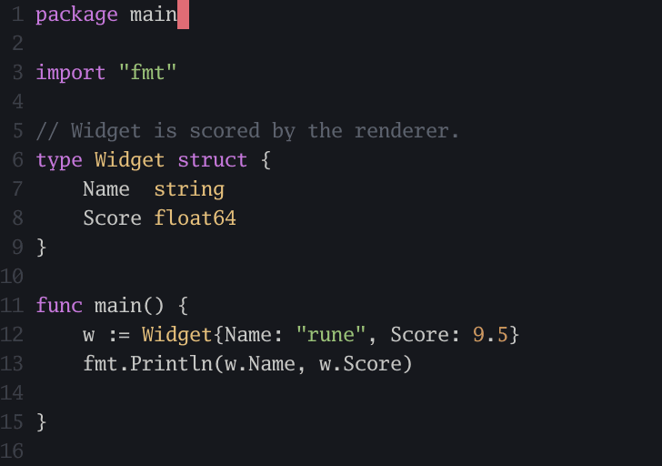

# Cursor pack for Rune

Shaders that play over Rune's window when the cursor jumps, such as to another
window or another part of a file. Installing the pack turns on the lightning
shader. Typing, `Enter` and moves to the line above or below play nothing.

## Shaders

### Lightning


A bolt forks its way from where the cursor was to where it jumped, then flashes
three times and lights up the text around it. Each jump draws a different bolt.

- Path: `$RUNE_DATADIR/lib/github.com/ernestrc/rune-cursor-pack/shaders/lightning.kage`
- Suggested duration: `350ms`

### Flame



A tapered flame stretches from where the cursor was, and its tail burns down
into the cursor. It's the trail Rune plays when `gui.cursor_effect.shader` is
empty.

- Path: `$RUNE_DATADIR/lib/github.com/ernestrc/rune-cursor-pack/shaders/flame.kage`
- Suggested duration: `250ms`

## Install

Cursor shaders need the Rune GUI, in a version that has the
`gui.cursor_effect` setting. In the Rune console, run:

```text
pkg install github.com/ernestrc/rune-cursor-pack
```

Then restart Rune: it loads the cursor shader when it starts.

The install turns the effect on with the lightning shader. If your config
already sets `gui.cursor_effect`, Rune keeps your values, so set them yourself
as shown below.

## Switch shaders

Set `shader` to the path of a shader above, and `duration` to its suggested
value, then restart Rune:

```yaml
gui:
  cursor_effect:
    enabled: true
    shader: $RUNE_DATADIR/lib/github.com/ernestrc/rune-cursor-pack/shaders/flame.kage
    duration: 250ms
```

```python
config["gui"]["cursor_effect"]["enabled"] = True
config["gui"]["cursor_effect"]["shader"] = "$RUNE_DATADIR/lib/github.com/ernestrc/rune-cursor-pack/shaders/flame.kage"
config["gui"]["cursor_effect"]["duration"] = "250ms"
```

To turn the effect off, set `enabled` to `false`.

## Write your own

The shaders are written in [Kage](https://ebitengine.org/en/documents/shader.html),
the shading language of Ebitengine, which draws Rune's window. See
[Cursor effect](https://docs.rune.build/docs/config#cursor-effect) in Rune's
config docs for the values Rune gives a shader, and for the `MinJumpRows` and
`MinJumpColumns` constants that decide how far the cursor must move to play it.
Both shaders here keep the defaults, so typing never pays for a redraw of the
whole window.

To add a shader to the pack, add `shaders/<name>.kage`, a preview at
`previews/<name>.gif`, a section above, and a line in the comment of
`config.yaml`.