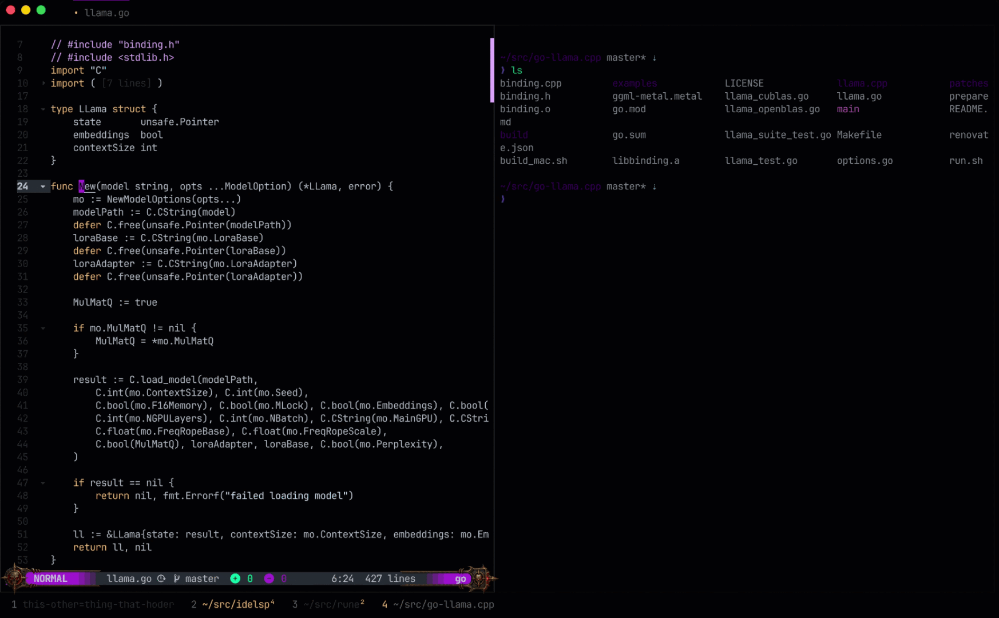
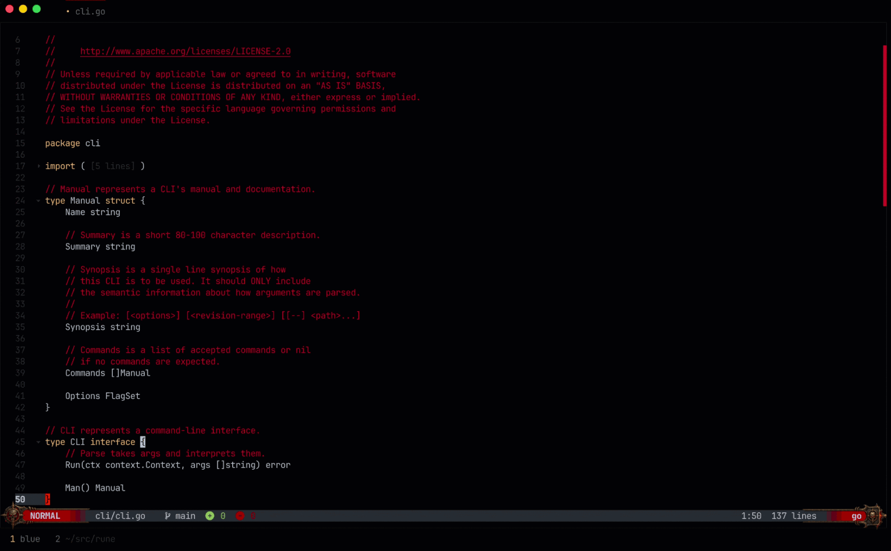
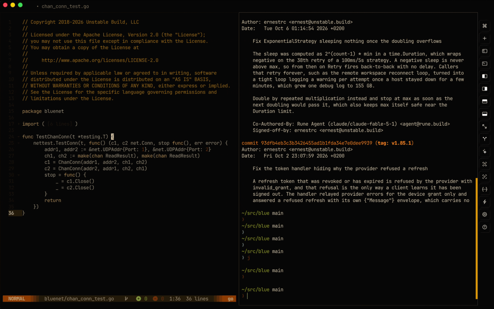
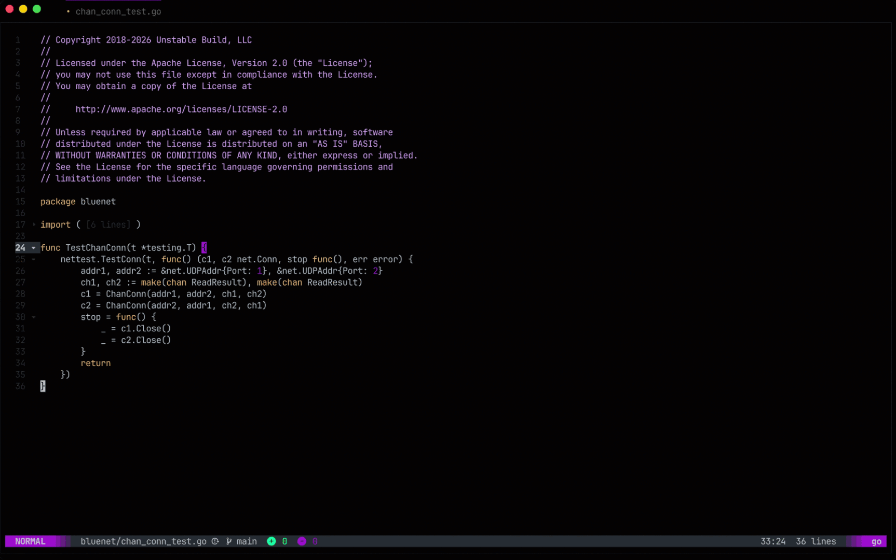

# Cursor shaders pack for Rune

Shaders that play when the cursor jumps, such as to another window or another part of a
file. Installing the pack configures your instance of Rune to use the lightning color
shader.

## Shaders

### Lightning



A bolt forks its way from where the cursor was to where it jumped, then flashes
three times and lights up the text around it. Each jump draws a different bolt.

- Path: `$RUNE_DATADIR/lib/github.com/unstablebuild/rune-cursor-pack/shaders/lightning.kage`
- Suggested duration: `350ms`

### Lightning color

The lightning bolt, but its glow, the flash at the cursor and the light it
throws on the text take your theme's cursor color. The core stays white-hot.
A gray or black cursor strikes a white bolt.

- Path: `$RUNE_DATADIR/lib/github.com/unstablebuild/rune-cursor-pack/shaders/lightning_color.kage`
- Suggested duration: `350ms`

### Fire trail



A tapered flame stretches from where the cursor was, and its tail burns down
into the cursor. It's the trail Rune plays when `animations.cursor.shader` is
empty.

- Path: `$RUNE_DATADIR/lib/github.com/unstablebuild/rune-cursor-pack/shaders/fire-trail.kage`
- Suggested duration: `250ms`

### Fire



A fuse burns from where the cursor was to where it jumped, spitting sparks, and
the cursor bursts into flame when the fuse reaches it. The flames twist and
lick up over the lines above, crackle and throw sparks, and ripple the text in
their heat. Their flickering light falls across the code around
them, then they die down to embers and a wisp of smoke.

- Path: `$RUNE_DATADIR/lib/github.com/unstablebuild/rune-cursor-pack/shaders/fire.kage`
- Suggested duration: `800ms`

### Smear



A solid smear in your theme's cursor color stretches between positions, then
contracts into the cursor with cubic ease-out. One corner lingers behind the
others for an elastic finish.

- Path: `$RUNE_DATADIR/lib/github.com/unstablebuild/rune-cursor-pack/shaders/smear.kage`
- Suggested duration: `300ms`

## Install

Cursor shaders need the Rune GUI, in a version that has the
`animations.cursor` setting. In the Rune console, run:

```text
pkg install github.com/unstablebuild/rune-cursor-pack
```

Then restart Rune: it loads the cursor shader when it starts.

The install turns the effect on with the lightning color shader. If your config
already sets `animations.cursor`, Rune keeps your values, so set them yourself
as shown below.

## Switch shaders

Set `shader` to the path of a shader above, and `duration` to its suggested
value, then restart Rune:

```yaml
animations:
  cursor:
    enabled: true
    shader: $RUNE_DATADIR/lib/github.com/unstablebuild/rune-cursor-pack/shaders/fire-trail.kage
    duration: 250ms
```

```python
config["animations"]["cursor"]["enabled"] = True
config["animations"]["cursor"]["shader"] = "$RUNE_DATADIR/lib/github.com/unstablebuild/rune-cursor-pack/shaders/fire-trail.kage"
config["animations"]["cursor"]["duration"] = "250ms"
```

To turn the effect off, set `enabled` to `false`.

## Write your own

The shaders are written in [Kage](https://ebitengine.org/en/documents/shader.html),
the shading language of Ebitengine, which draws Rune's window. See
[Write your own](https://docs.rune.build/learn/animations#write-your-own) in
Rune's Animations guide for the values Rune gives a shader, and for the
`MinJumpRows` and `MinJumpColumns` constants that decide how far the cursor
must move to play it. All the shaders here keep the defaults, so typing never
pays for a redraw of the whole window.

## Test

The test module uses Rune's Ebitengine fork to compile every shader and render
Smear and Lightning color on a real graphics backend. It checks Smear's jump
directions, block/bar/underline cursors, shape changes, collapsed edges,
timing, and alpha blending, and that Lightning color's bolt takes the cursor's
color.
Run it in a graphical session; it briefly opens a small test window:

```sh
cd tests
go test -count=1 ./...
```

For GPU-rendered PNG frames to inspect, set `RUNE_SHADER_TEST_IMAGES` to an
output directory when running the tests. These are test images, not Rune
screen recordings.
